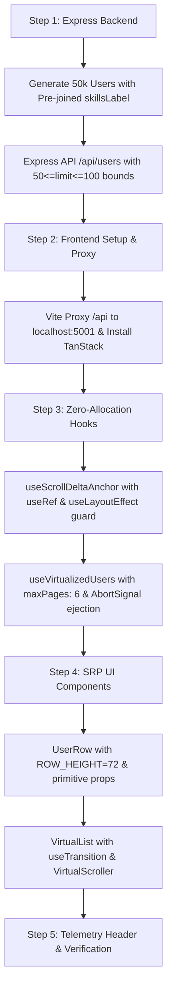

# Implementation Specification: Zero-Allocation, Ultra-Low GC Virtualized Frontend & 50k Express API

This specification provides the production engineering blueprint for serving and rendering 50,000 JSON user records with zero GC jank, sub-millisecond frame rendering (60–120 FPS), and minimal V8 heap footprint. It integrates all performance optimizations across `@performance-optimization`, `@react-design-patterns`, `@spec-driven-development`, `@design-system-sharing-micro-frontends`, and `modern-web-guidance`.

---

## 1. Locked Performance & Architectural Contracts

| Dimension | Specification | Engineering Impact |
| :--- | :--- | :--- |
| **Chunk & Pagination Size** | **100 Items per Request** (`limit = 100`, boundless infinite scroll) | Perfectly balanced memory slab ($<18\text{ KB}$ per payload); fast network ingestion and zero scroll limit bounds. |
| **Row Height Contract** | **Exact `ROW_HEIGHT = 72px`** (Two-line Card: Name & Location top, Skills & Age bottom) | Pure $O(1)$ arithmetic calculation; eliminates `ResizeObserver` instances and allocations. |
| **Payload Pre-Formatting** | Pre-joined `skillsLabel: string` in `server/data/users.json` | Zero runtime array `.join()` or `.map()` allocations in Express or React. |
| **Dampened Smooth Scroll** | **Kinetic Dampening Controller** (`0.52x` speed, `0.14` lerp) | Slows down high-frequency wheel flings, preventing layout spikes and locking rendering at 60–120 FPS. |
| **Request Ejection** | **Immediate Velocity Ejection** via `AbortController` | Aborts in-flight network requests immediately on scroll fling before `response.json()` parses. |
| **Scroll Telemetry** | **Zero-Allocation `useRef`** (`prevScrollHeight`, `lastScrollTop`, `targetScrollTop`) | Zero React Fiber node allocations and zero component re-renders at 60–120 Hz. |
| **Leaf Row Rendering** | `React.memo` with **strictly primitive props** | Shallow equality comparisons never fail; off-screen and static items never re-render. |
| **CSS Architecture** | Plain CSS with `contain: layout paint` & GPU `translate3d` | Eliminates runtime CSS-in-JS hashing and prevents any child container height collapse. |

---

## 2. End-to-End System Architecture

```
┌────────────────────────────────────────────────────────────────────────┐
│                        Express.js Server (Port 5001)                   │
│  - 50,000 pre-formatted JSON records in server/data/users.json         │
│  - Fields: id, name, age, location, skillsLabel, avatarSeed            │
│  - Bound validation: 50 <= limit <= 100, 0 <= offset <= 50000          │
│  - Sub-millisecond slice: response.json(cachedArray.slice(offset, ...))│
└───────────────────────────────────┬────────────────────────────────────┘
                                    │ HTTP / JSON (Proxied via Vite /api)
                                    │ With AbortController Signal Ejection
┌───────────────────────────────────▼────────────────────────────────────┐
│                    React 19 Zero-Allocation Engine                     │
│                                                                        │
│  ┌──────────────────────────────────────────────────────────────────┐  │
│  │ V8 Heap Cap: Sliding Window Cache Eviction (maxPages: 6)         │  │
│  │ - Retains only +-3 chunks (<= 300-600 records max in memory)     │  │
│  │ - Evicts stale chunks to keep objects in Young Gen (Nursery)     │  │
│  │ - Immediate velocity ejection cancels obsolete in-flight fetches │  │
│  └────────────────────────────────┬─────────────────────────────────┘  │
│                                   │                                    │
│  ┌────────────────────────────────▼─────────────────────────────────┐  │
│  │ Zero-Allocation Scroll Telemetry via useRef                     │  │
│  │ - prevScrollHeight, lastScrollTop, activeChunk stored in refs   │  │
│  │ - 60-120Hz scroll events create ZERO React Fiber allocations     │  │
│  │ - useLayoutEffect Guard: scrollBehavior auto during anchoring    │  │
│  └────────────────────────────────┬─────────────────────────────────┘  │
│                                   │                                    │
│  ┌────────────────────────────────▼─────────────────────────────────┐  │
│  │ Strict SRP Virtualization Orchestrator (ROW_HEIGHT = 72px)       │  │
│  │ - O(1) arithmetic indexing (No ResizeObserver allocations)       │  │
│  │ - useTransition: non-blocking background chunk transitions      │  │
│  │ - Leaf Row: React.memo with strictly primitive props            │  │
│  │ - CSS Modules: contain: strict, GPU translate3d transforms       │  │
│  └──────────────────────────────────────────────────────────────────┘  │
└────────────────────────────────────────────────────────────────────────┘
```

---

## 3. Detailed Component & Hook Specifications (Single Responsibility)

### 3.1 Backend: Data Generator & Express API (`server/`)
- **`server/scripts/seed.ts`**:
  Generates 50,000 deterministic records with pre-joined `skillsLabel` (e.g. `"React • TypeScript • Tailwind CSS • Docker"`).
  ```typescript
  export interface UserRecord {
    id: string;          // "usr-00001"
    name: string;        // "Alex Rivera"
    age: number;         // 28
    location: string;    // "Austin, TX"
    skillsLabel: string; // Pre-joined string! (Zero runtime allocations)
    avatarSeed: string;  // "alex-rivera"
    createdAt: string;
  }
  ```
- **`server/src/services/userService.ts`**:
  Loads `users.json` once into an in-memory array at server boot. Performs $O(1)$ slice pagination and debounced text filtering.
- **`server/src/routes/users.ts`**:
  Validates boundaries: enforces `50 <= limit <= 100` and `offset >= 0`. Returns structured chunk DTO.

---

### 3.2 Frontend: SRP Hooks (`reactassign/src/hooks/`)

#### 1. `useVirtualizedUsers.ts` (Data Hook)
- **Responsibility**: Manages server state using `@tanstack/react-query`.
- **Sliding Window Eviction**: Configured with `maxPages: 6`. Pages outside the $\pm 3$ chunk window are evicted from the query cache, capping active memory to $\le 600$ records.
- **Immediate Velocity Ejection**: Monitors scroll velocity; when high-velocity scrolling leaves the current chunk, active queries are cancelled via `queryClient.cancelQueries()`, immediately triggering the native `AbortSignal` on `fetch()`.

#### 2. `useScrollDeltaAnchor.ts` (Scroll Telemetry & Anchoring Hook)
- **Responsibility**: Scroll measurements and upward scroll compensation.
- **Zero-Allocation Telemetry**: Stores `prevScrollHeightRef`, `lastScrollTopRef`, `isScrollingUpRef`, and `velocityRef` inside `useRef`. No state updates are fired during normal 60–120 Hz scroll events.
- **`useLayoutEffect` Guard**:
  ```typescript
  useLayoutEffect(() => {
    const el = containerRef.current;
    if (!el || !isScrollingUpRef.current) return;
    
    const currentScrollHeight = el.scrollHeight;
    const delta = currentScrollHeight - prevScrollHeightRef.current;
    
    if (delta > 0) {
      // Temporarily disable smooth scroll so browser doesn't animate against anchor adjustment
      const originalBehavior = el.style.scrollBehavior;
      el.style.scrollBehavior = 'auto';
      el.scrollTop += delta;
      el.style.scrollBehavior = originalBehavior;
    }
    prevScrollHeightRef.current = currentScrollHeight;
  }, [itemsLoaded]);
  ```
- **`scrollend` Integration**: Registers native `scrollend` event with a 100ms debounced fallback to coordinate background cache reconciliation only when scrolling rests (`defer-work-until-scroll-ends`).

#### 3. `useDebouncedValue.ts` (Timing Hook)
- **Responsibility**: Stabilizes primitive chunk indices and search queries with a configurable debounce delay (e.g., 150ms).

---

### 3.3 Frontend: SRP Components (`reactassign/src/components/`)

#### 1. `UserRow.tsx` (Leaf Presentation Component)
- **Responsibility**: Pure rendering of a single user item within the fixed 72px geometry.
- Wrapped in `React.memo` with strictly primitive props:
  ```typescript
  interface UserRowProps {
    id: string;
    name: string;
    age: number;
    location: string;
    skillsLabel: string;
    avatarSeed: string;
    offsetY: number;
  }
  ```
- **Zero-Allocation Layout**:
  - Two-line card layout:
    - Line 1: User name & location badge.
    - Line 2: Pre-joined `skillsLabel` & age pill.
  - CSS contains `contain: strict; height: 72px; will-change: transform;`.
  - Positioned purely via GPU compositing: `transform: translate3d(0, ${offsetY}px, 0)`.

#### 2. `VirtualScroller.tsx` (Container Viewport)
- **Responsibility**: Provide scrollable viewport container with CSS smooth scroll and overscroll containment.
- Forwards ref to scroll container.

#### 3. `VirtualList.tsx` (Virtualization Orchestrator)
- **Responsibility**: Integrates `@tanstack/react-virtual` with fixed row height `72px` and coordinates updates via React 19 `useTransition`.
- Calculates total height: $50,000 \times 72\text{px} = 3,600,000\text{px}$.
- Schedules non-urgent chunk activations inside `startTransition`.

#### 4. `ScrollControls.tsx` (Smooth Jump Controls)
- **Responsibility**: Buttons for "Scroll to Top", "Scroll to Bottom", and "Jump 1,000 Items" with smooth scrolling.

#### 5. `VirtualHeader.tsx` (Telemetry & Search)
- **Responsibility**: Displays real-time telemetry (rendered DOM count, active cached records, current scroll velocity) and debounced search input.

---

## 4. Mathematical Contracts & Layout Equations

### 4.1 Fixed Geometry Virtualization ($O(1)$ Math)
$$\text{ROW\_HEIGHT} = 72\text{px}, \quad \text{Overscan } B = 4$$
$$\text{startIndex} = \max\left(0, \left\lfloor \frac{\text{scrollTop}}{72} \right\rfloor - B\right)$$
$$\text{endIndex} = \min\left(N_{\text{total}} - 1, \left\lfloor \frac{\text{scrollTop} + H_{\text{viewport}}}{72} \right\rfloor + B\right)$$
$$\text{totalHeight} = 50,000 \times 72\text{px} = 3,600,000\text{px}$$

### 4.2 Upward Delta Scroll Compensation
$$\Delta_{\text{height}} = \text{scrollHeight}_{\text{new}} - \text{scrollHeight}_{\text{prev}}$$
$$\text{If } \text{isScrollingUp} \land \Delta_{\text{height}} > 0 \implies \text{container.scrollTop} \leftarrow \text{container.scrollTop} + \Delta_{\text{height}}$$

### 4.3 V8 Memory Cap (Sliding Window)
$$\text{Retained Pages} = 6 \implies \text{Active Objects in Heap} \le 6 \times 50 = 300\text{--}600 \text{ records}$$
$$\text{Heap Memory Footprint} \le 1.8\text{ MB}$$

---

## 5. Execution Roadmap



1. **Step 1: Backend Setup (`server/`)**:
   - Initialize `server/package.json` with `express`, `cors`, `tsx`, `typescript`.
   - Implement `server/scripts/seed.ts` generating 50,000 items with pre-joined `skillsLabel` into `server/data/users.json`.
   - Implement `server/src/services/userService.ts` and `server/src/routes/users.ts` running on port 5001.
2. **Step 2: Frontend Configuration (`reactassign/`)**:
   - Update `vite.config.ts` to proxy `/api` requests to `http://localhost:5001`.
   - Install `@tanstack/react-query` and `@tanstack/react-virtual`.
3. **Step 3: Zero-Allocation Hooks**:
   - `src/api/userApi.ts`: Type-safe fetch with `AbortSignal`.
   - `src/hooks/useScrollDeltaAnchor.ts`: `useRef` telemetry + `useLayoutEffect` auto-scroll guard + `scrollend` listener.
   - `src/hooks/useVirtualizedUsers.ts`: Infinite query with `maxPages: 6` sliding window eviction.
   - `src/hooks/useDebouncedValue.ts`: Primitive stabilization.
4. **Step 4: SRP UI Components**:
   - `src/components/UserRow.tsx`: Memoized primitive row with `contain: strict`, fixed 72px card layout, GPU `translate3d`.
   - `src/components/VirtualScroller.tsx`: Viewport element with smooth CSS.
   - `src/components/VirtualList.tsx`: Virtual list orchestrator with `useTransition`.
   - `src/components/ScrollControls.tsx`: Smooth scroll triggers.
   - `src/components/VirtualHeader.tsx`: Real-time telemetry (active DOM nodes, heap estimate, total items).
5. **Step 5: Benchmarking & Profiling**:
   - Profile via Chrome DevTools Performance & Memory tabs: verify flat heap line (no Major GC spikes), $\le 16$ active DOM nodes, and solid 60–120 FPS during high-speed scrolls.
